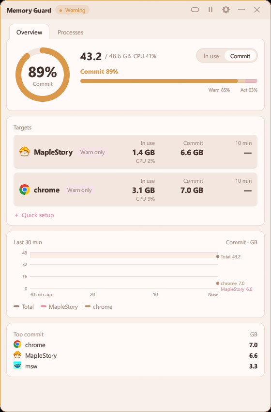
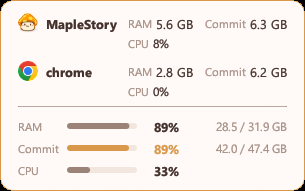
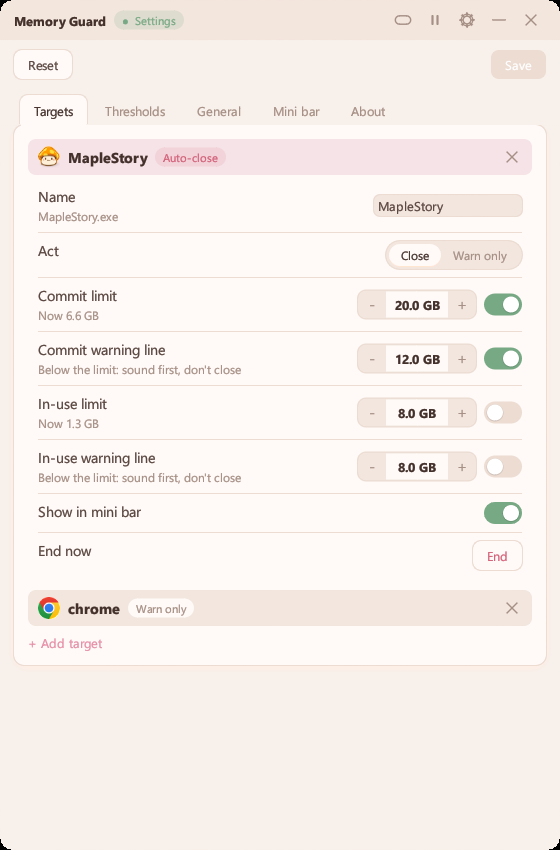
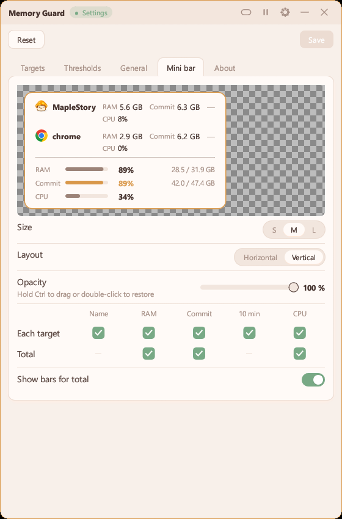

# Memory Guard

[繁體中文](README.md) | **English** | [日本語](README.ja.md) | [한국어](README.ko.md)


Watches the "Committed" memory in Task Manager, warns you when it's nearly full, and can close a program you picked before the whole PC freezes.

<p>
  
  
  
  
</p>

## Highlights

- **Commit, not just memory**: once commit hits the limit, programs start crashing even with physical RAM free.
- **Warn and auto-close**: each target can have its own commit and in-use limits and warning lines. To watch the whole PC too, turn on whole-PC thresholds in Thresholds (off by default): it notifies you at the warning level, and at the action level closes the top program only if it's a target set to "Close".
- **Processes**: lists every program like Task Manager, sortable by memory, CPU, and GPU; right-click to end the task, copy its name, or open its folder.
- **Mini bar**: semi-transparent, always on top, clicks pass through; hold Ctrl to drag. Pick what it shows.
- **Read-only**: only reads memory counters; the one thing that touches other programs is "Close".

## How to use

Fastest way: press "Quick setup" on the main screen, pick your game, say what usually goes wrong, and choose whether to just warn or close it. The numbers are filled in from your PC's memory. For finer control, follow the steps below.

1. Run `mem_guard.exe` and click the gear at the top right to open Settings.
2. In Targets, click "Add target" and pick the programs to watch (a game, a browser).
3. To watch the whole PC too, turn on "Whole-PC thresholds" in Thresholds (off by default), then set the warning and action levels; defaults are 85% and 93%.
4. Back on the main window, click a target's row to choose "Close" or "Warn only", and turn on a commit or in-use limit if you need one. With "Close" you can also turn on a warning line: it sounds there first and closes only at the limit.
5. Click the bar button in the title bar to shrink into the mini bar. Hold Ctrl to drag it, double-click or click the tray icon to restore. Pick what it shows in the Mini bar tab in Settings.
6. While warning, click the status in the title bar to mute, click again to unmute. Pause keeps warning but never closes anything and stays silent.
7. The About tab in Settings checks for updates; it only goes online when you click it.

<p>
  
  
</p>

## Performance

Measured on the author's PC (10 s after launch, then over 60 s):

| | Main window | Mini bar |
|---|---|---|
| Memory (Task Manager "Memory" column) | 7.6 MB | 3.9 MB |
| Memory with GPU usage on | 11.8 MB | 10.0 MB |
| CPU time per minute | 0.6 s | 0.2 s |

Launch to visible window: about 0.35 s the first time, 0.04–0.06 s after that. The executable is 3.5 MB.

## Build

Needs Rust with the MSVC toolchain.

```
cargo build --release
```

The executable is at `target\release\mem_guard.exe`; settings and logs sit next to it.

## License

Released under the GNU GPL 3.0; see [LICENSE](LICENSE) for the full text. You may use, modify and share it freely; if you share a modified version, you must publish its source under GPL 3.0 as well.

## Disclaimer

This is a free tool made by an individual, provided for learning and development testing only. It is not affiliated with NEXON or MapleStory.

It is provided as is, with no guarantee that it is free of errors or fit for any purpose. The author is not responsible for any loss from using it, including but not limited to game account penalties, progress lost when a game is closed automatically, data loss, or computer problems. Use it at your own risk.

It only reads memory and process information provided by Windows. It never reads or writes a game's memory and never modifies game files.
