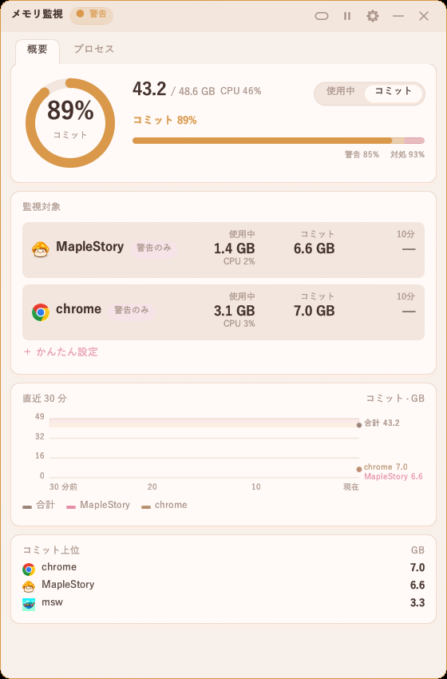
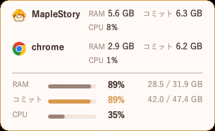
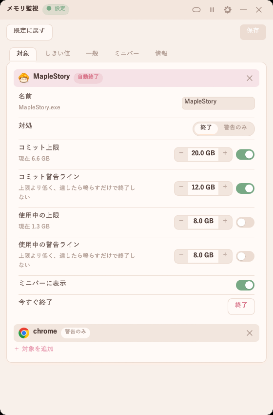
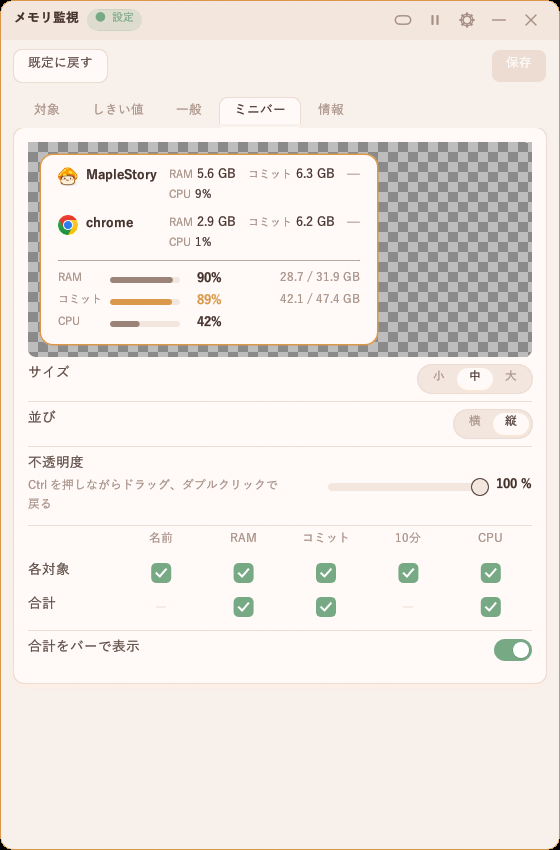

# メモリ監視

[繁體中文](README.md) | [English](README.en.md) | **日本語** | [한국어](README.ko.md)


タスクマネージャーの「コミット済み」メモリを見張り、いっぱいに近づいたら警告し、PC 全体が固まる前に指定したプログラムを終了できます。

<p>
  
  
  
  
</p>

## 特長

- **メモリだけでなくコミットを見る**：コミットが上限に達すると、物理メモリに空きがあってもプログラムが次々に落ちます。
- **警告と自動終了**：警告ラインで通知。対処ラインでは、最も多く使っているのが「終了」に設定した対象の場合だけ終了します。対象ごとにコミット・使用中の上限も設定できます。
- **プロセス**：タスクマネージャーのように全プログラムを一覧表示し、メモリ・CPU・GPU で並べ替え。右クリックでタスクの終了、名前のコピー、フォルダを開くができます。
- **ミニバー**：半透明・最前面・クリックは下に通過。Ctrl を押しながらドラッグ。表示項目は自由に選べます。
- **読むだけ**：メモリカウンタを読むだけで、他のプログラムに触れるのは「終了」のみ。

## 使い方

いちばん簡単なのは、メイン画面の「かんたん設定」です。ゲームを選び、よく起きる症状を選び、警告だけか自動終了かを選ぶだけで、数値は PC のメモリに合わせて入ります。細かく決めたいときは下の手順で。

1. `mem_guard.exe` を開き、右上の歯車で設定へ。
2. 「対象」タブの「対象を追加」で、見張りたいプログラム（ゲーム、ブラウザなど）を選ぶ。
3. 「しきい値」タブで警告と対処の割合を設定（既定は 85% と 93%）。
4. メイン画面で対象の行をクリックし、「終了」か「警告のみ」を選ぶ。必要ならコミット上限や使用中の上限をオン。「終了」のときは警告ラインも設定でき、そこで先に鳴らし、上限で終了します。
5. タイトルバーのバーボタンでミニバーに。Ctrl を押しながらドラッグ、ダブルクリックかトレイアイコンで元に戻す。表示項目は設定の「ミニバー」タブで選ぶ。
6. 警告中はタイトルバーの状態をクリックで消音、もう一度で解除。一時停止中は警告のみで、終了も音もありません。
7. 設定の「情報」タブで更新を確認できます。押したときだけ通信します。

<p>
  
  
</p>

## パフォーマンス

作者の PC で計測（起動 10 秒後から 60 秒間）：

| | メイン画面 | ミニバー |
|---|---|---|
| メモリ（タスクマネージャーの「メモリ」列） | 7.6 MB | 3.9 MB |
| GPU 使用率オン時のメモリ | 11.8 MB | 10.0 MB |
| 1 分あたりの CPU 時間 | 0.6 秒 | 0.2 秒 |

起動からウィンドウ表示まで：初回約 0.35 秒、2 回目以降 0.04〜0.06 秒。実行ファイルは 3.5 MB。

## ビルド

Rust（MSVC ツールチェーン）が必要です。

```
cargo build --release
```

実行ファイルは `target\release\mem_guard.exe`。設定ファイルとログはその隣に置かれます。

## ライセンス

GNU GPL 3.0 で公開しています。全文は [LICENSE](LICENSE) を参照してください。自由に使用・改変・再配布できますが、改変版を配布する場合はソースコードを同じく GPL 3.0 で公開する必要があります。

## 免責事項

本ソフトは個人が作成した無料ツールで、学習と開発テストのためだけに提供しています。NEXON およびメイプルストーリー公式とは関係ありません。

本ソフトは現状のまま提供され、誤りがないことや特定の用途に適することは保証しません。本ソフトの使用によって生じたいかなる損害（ゲームアカウントの処分、ゲームが自動終了して失われた進行、データの消失、PC の不具合などを含み、これらに限りません）についても、作者は一切責任を負いません。自己責任でご利用ください。

本ソフトは Windows が提供するメモリとプロセスの情報を読み取るだけで、ゲームのメモリを読み書きしたり、ゲームのファイルを変更したりすることはありません。
