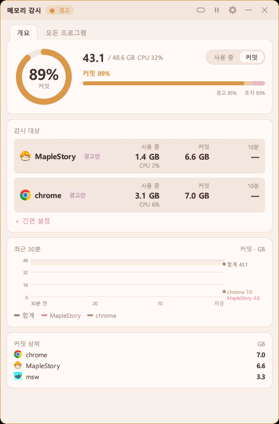
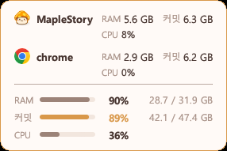
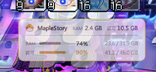
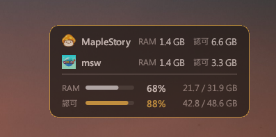
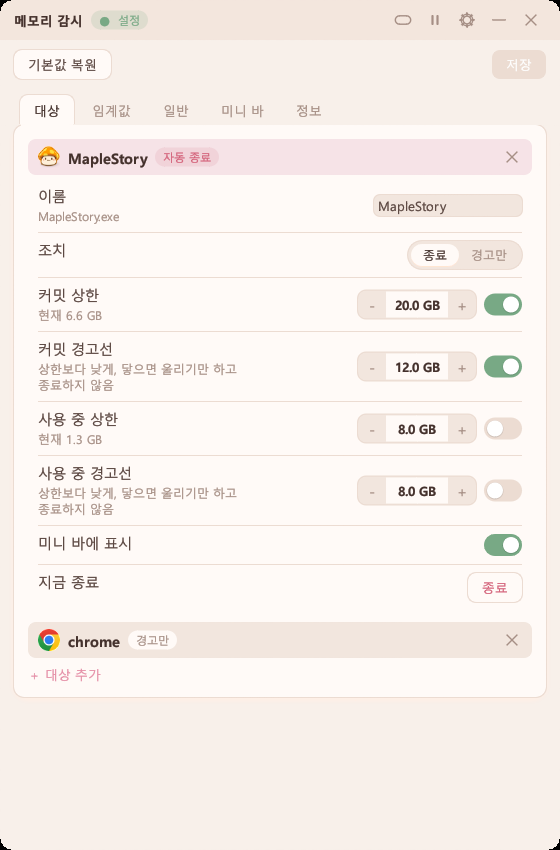
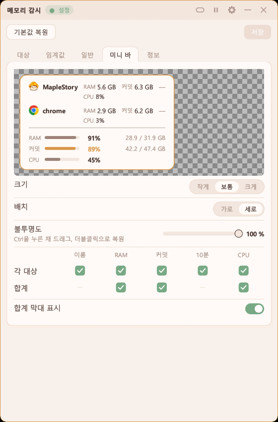

# 메모리 감시

[繁體中文](README.md) | [English](README.en.md) | [日本語](README.ja.md) | **한국어**


작업 관리자의 '커밋됨' 메모리를 지켜보다가 거의 찼을 때 경고하고, PC 전체가 멈추기 전에 지정한 프로그램을 종료할 수 있습니다.

<p>
  
  
  
  
</p>

## 특징

- **메모리만이 아니라 커밋을 본다**: 커밋이 한도에 닿으면 실제 메모리에 여유가 있어도 프로그램이 줄줄이 꺼집니다.
- **경고와 자동 종료**: 경고 비율에서 알림. 조치 비율에서는 가장 많이 쓰는 프로그램이 '종료'로 설정한 대상일 때만 종료합니다. 대상마다 커밋·사용 중 상한도 따로 설정할 수 있습니다.
- **모든 프로그램**: 작업 관리자처럼 모든 프로그램을 나열하고 메모리·CPU·GPU로 정렬. 오른쪽 클릭으로 작업 끝내기, 이름 복사, 폴더 열기.
- **미니 바**: 반투명, 항상 위, 클릭은 아래로 통과. Ctrl을 누른 채 드래그. 표시 항목을 고를 수 있습니다.
- **읽기만 함**: 메모리 카운터만 읽고, 다른 프로그램을 건드리는 건 '종료'뿐입니다.

## 사용법

가장 빠른 방법은 메인 화면의 "간편 설정"입니다. 게임을 고르고, 자주 생기는 문제를 고르고, 경고만 할지 종료할지 고르면 숫자는 PC 메모리에 맞춰 채워집니다. 세세하게 조정하려면 아래 순서를 따르세요.

1. `mem_guard.exe`를 열고 오른쪽 위 톱니바퀴로 설정에 들어갑니다.
2. '대상' 탭에서 '대상 추가'를 눌러 지켜볼 프로그램(게임, 브라우저 등)을 고릅니다.
3. '임계값' 탭에서 경고와 조치 비율을 정합니다(기본 85%, 93%).
4. 메인 화면에서 대상 줄을 클릭해 '종료' 또는 '경고만'을 고르고, 필요하면 커밋 상한이나 사용 중 상한을 켭니다. '종료'일 때는 경고선도 켤 수 있어, 거기서 먼저 울리고 상한에서 종료합니다.
5. 제목 표시줄의 바 버튼으로 미니 바로 줄입니다. Ctrl을 누른 채 드래그, 더블클릭이나 트레이 아이콘으로 복원. 표시 항목은 설정의 '미니 바' 탭에서 고릅니다.
6. 경고 중에는 제목 표시줄의 상태를 클릭하면 음소거, 다시 클릭하면 해제. 일시 정지 중에는 경고만 하고 종료도 소리도 없습니다.
7. 설정의 '정보' 탭에서 업데이트를 확인할 수 있습니다. 누를 때만 인터넷에 연결합니다.

<p>
  
  
</p>

## 성능

작성자 PC에서 측정(실행 10초 후부터 60초 동안):

| | 메인 화면 | 미니 바 |
|---|---|---|
| 메모리(작업 관리자 '메모리' 열) | 7.6 MB | 3.9 MB |
| GPU 사용률을 켰을 때 메모리 | 11.8 MB | 10.0 MB |
| 1분당 CPU 시간 | 0.6초 | 0.2초 |

실행부터 창이 보이기까지: 처음 약 0.35초, 그 뒤 0.04~0.06초. 실행 파일은 3.5 MB입니다.

## 빌드

Rust(MSVC 툴체인)가 필요합니다.

```
cargo build --release
```

실행 파일은 `target\release\mem_guard.exe`에 있고, 설정 파일과 기록은 그 옆에 저장됩니다.
