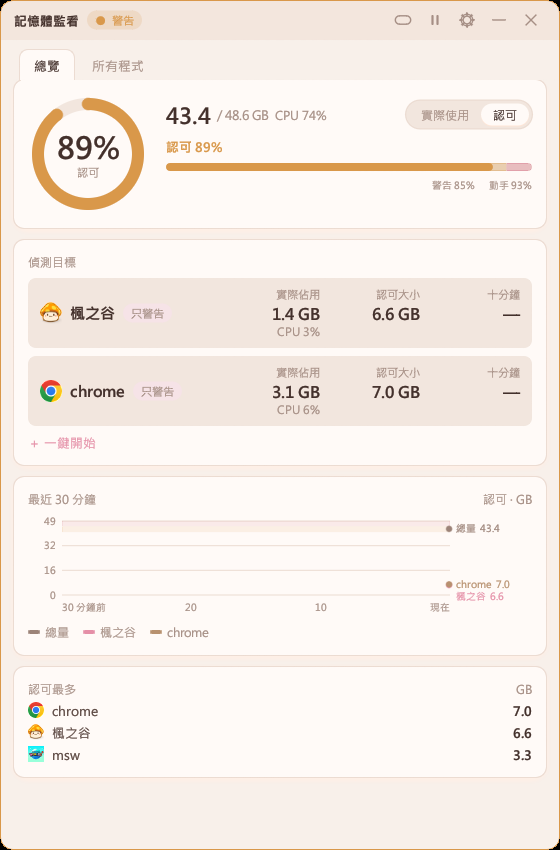
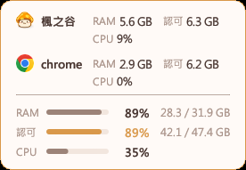
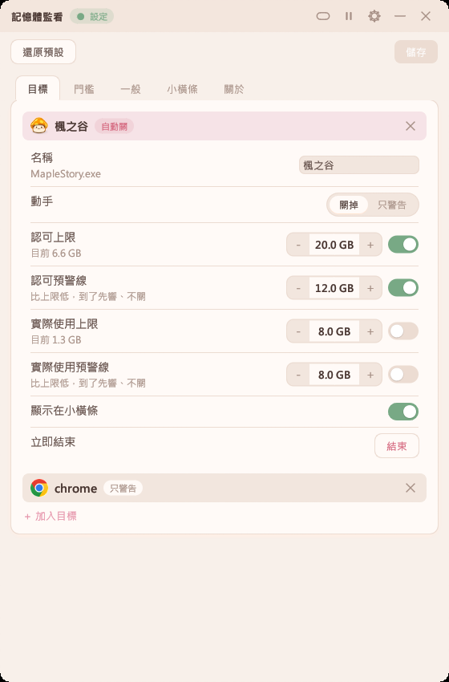
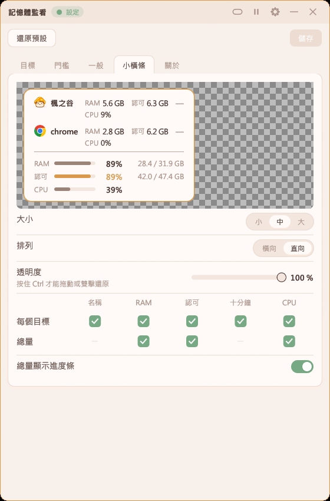

# 記憶體監看

**繁體中文** | [English](README.en.md) | [日本語](README.ja.md) | [한국어](README.ko.md)


盯住工作管理員裡的「已認可」記憶體，快滿時警告，必要時自動關掉你指定的程式，免得整台卡死。

<p>
  
  
  
  
</p>

## 重點

- **看認可，不只看記憶體**：認可撞到上限，就算實體記憶體還有空，程式也會接連掛掉。
- **警告與自動關掉**：整台到警告比例就通知；到動手比例，且吃最多的是你設成「關掉」的目標才關。每個目標也能另設認可、實際使用兩個上限。
- **所有程式**：像工作管理員一樣列出全部程式，可照記憶體、CPU、GPU 排序；右鍵可結束工作、複製名稱、打開資料夾。
- **小橫條**：半透明、置頂、點擊穿透，按住 Ctrl 才能拖；顯示項目可自訂。
- **只讀不碰**：只讀記憶體計數器，唯一會動到別的程式的是「關掉」。

好了就你楓之谷最會溢出記憶體，每次都把電腦擠完，32G不夠吃，別人的64GB你也不夠吃，再吃把你砍掉
## 使用教學

最快的方法：打開後在主畫面按「一鍵開始」，挑遊戲、選比較常遇到的狀況、選要提醒還是直接關掉，數字會照你電腦的記憶體先填好。想自己細調再照下面的步驟。

1. 打開 `mem_guard.exe`，按右上角齒輪進設定。
2. 「目標」分頁按「加入目標」，從正在跑的程式挑你要盯的（例如遊戲、瀏覽器）。
3. 「門檻」分頁調警告與動手的比例；預設 85% 警告、93% 動手。
4. 回主畫面點目標那一列，選「關掉」或「只警告」，需要的話開認可上限或實際使用上限。選「關掉」時還能另開預警線，到了先響、到上限才關。
5. 按標題列的橫條鈕縮成小橫條；按住 Ctrl 拖到想放的位置，雙擊回完整視窗，點系統匣圖示也能還原。小橫條要顯示什麼在設定的「小橫條」分頁勾。
6. 警告時點標題列的狀態可以靜音，再點一次取消；按暫停鍵則照樣警告但不關程式、也不出聲。
7. 設定的「關於」分頁可以檢查更新；只有按下去時才會連網。

<p>
  
  
</p>

## 效能

在作者電腦上實測（開啟後等 10 秒，再量 60 秒）：

| 項目 | 主畫面 | 小橫條 |
|---|---|---|
| 記憶體（工作管理員「記憶體」欄） | 7.6 MB | 3.9 MB |
| 記憶體，打開 GPU 用量 | 11.8 MB | 10.0 MB |
| 每分鐘 CPU 時間 | 0.6 秒 | 0.2 秒 |

開啟到看見視窗：第一次約 0.35 秒，之後約 0.04 到 0.06 秒。執行檔 3.5 MB。

## 建置

需要 Rust（MSVC 工具鏈）。

```
cargo build --release
```

執行檔在 `target\release\mem_guard.exe`，設定檔與紀錄放在它旁邊。

## 免責聲明

本程式為個人製作的免費工具，僅供學習與開發測試使用，與 NEXON 及楓之谷官方無關。

本程式依現狀提供，不保證沒有錯誤或適合任何用途。使用本程式造成的任何損失，包括但不限於遊戲帳號遭處分、遊戲被自動關閉而遺失的進度、資料遺失或電腦異常，作者一概不負責，請自行承擔使用風險。

本程式只讀取 Windows 提供的記憶體與處理程序資訊，不會讀寫遊戲的記憶體，也不會修改遊戲檔案。
